# FINANCIA — ERD Baseline

**Batch 1 / Phase 2 — design artifact only**  
**Version:** 1.0 · **Date:** 2026-11-23

This ERD describes the proposed relational model for one private household, two equal users, IDR-first accounting, and a gold-distribution business. It is a design baseline; it has not been applied to Supabase.

## 1. Entity relationship diagram

```mermaid
erDiagram
    HOUSEHOLDS ||--o{ HOUSEHOLD_MEMBERS : has
    PROFILES ||--o| HOUSEHOLD_MEMBERS : identifies

    HOUSEHOLDS ||--o{ LEDGER_ACCOUNTS : owns
    HOUSEHOLDS ||--o{ FINANCIAL_ACCOUNTS : owns
    LEDGER_ACCOUNTS ||--o| FINANCIAL_ACCOUNTS : maps_to

    HOUSEHOLDS ||--o{ TRANSACTION_CATEGORIES : defines
    HOUSEHOLDS ||--o{ TRANSACTIONS : records
    TRANSACTION_CATEGORIES ||--o{ TRANSACTIONS : classifies
    TRANSACTIONS ||--o| JOURNAL_ENTRIES : posts_as
    JOURNAL_ENTRIES ||--o{ JOURNAL_LINES : contains
    LEDGER_ACCOUNTS ||--o{ JOURNAL_LINES : receives
    FINANCIAL_ACCOUNTS ||--o{ JOURNAL_LINES : dimension_of

    HOUSEHOLDS ||--o{ ALLOCATION_PLANS : configures
    ALLOCATION_PLANS ||--o{ ALLOCATION_BUCKETS : groups
    ALLOCATION_PLANS ||--o{ ALLOCATION_RULES : defines
    ALLOCATION_BUCKETS ||--o{ ALLOCATION_RULES : target_of
    ALLOCATION_PLANS ||--o{ ALLOCATION_RUNS : executes
    TRANSACTIONS ||--o{ ALLOCATION_RUNS : source_of
    ALLOCATION_RUNS ||--|{ ALLOCATION_RUN_LINES : contains
    ALLOCATION_BUCKETS ||--o{ ALLOCATION_RUN_LINES : receives

    HOUSEHOLDS ||--o{ BUDGET_PERIODS : budgets
    BUDGET_PERIODS ||--o{ BUDGET_LINES : contains
    TRANSACTION_CATEGORIES ||--o{ BUDGET_LINES : limits
    HOUSEHOLDS ||--o{ SAVINGS_GOALS : targets

    HOUSEHOLDS ||--o{ ASSETS : holds
    LEDGER_ACCOUNTS ||--o{ ASSETS : represented_by
    ASSETS ||--o{ ASSET_MOVEMENTS : changes
    ASSETS ||--o{ ASSET_VALUATIONS : valued_by
    TRANSACTIONS ||--o{ ASSET_MOVEMENTS : records

    HOUSEHOLDS ||--o{ LIABILITIES : owes
    LEDGER_ACCOUNTS ||--o{ LIABILITIES : represented_by
    LIABILITIES ||--o{ LIABILITY_PAYMENTS : settled_by
    TRANSACTIONS ||--o{ LIABILITY_PAYMENTS : records

    HOUSEHOLDS ||--o{ BUSINESSES : operates
    BUSINESSES ||--o{ BUSINESS_PRODUCTS : sells
    BUSINESSES ||--o{ BUSINESS_DOCUMENTS : records
    TRANSACTIONS ||--o| BUSINESS_DOCUMENTS : posts_as
    BUSINESS_DOCUMENTS ||--o{ BUSINESS_DOCUMENT_LINES : contains
    BUSINESS_PRODUCTS ||--o{ BUSINESS_DOCUMENT_LINES : describes
    BUSINESS_PRODUCTS ||--o{ INVENTORY_MOVEMENTS : moves
    BUSINESS_DOCUMENT_LINES ||--o{ INVENTORY_MOVEMENTS : causes
    INVENTORY_MOVEMENTS ||--o{ INVENTORY_COST_ALLOCATIONS : consumed_from
    BUSINESS_DOCUMENT_LINES ||--o{ INVENTORY_COST_ALLOCATIONS : consumes

    HOUSEHOLDS ||--o{ RECEIPTS : stores
    TRANSACTIONS ||--o{ RECEIPTS : evidenced_by
    HOUSEHOLDS ||--o{ MARKET_PRICE_OBSERVATIONS : tracks

    HOUSEHOLDS ||--o{ AUDIT_EVENTS : audits
    PROFILES ||--o{ AUDIT_EVENTS : actor
```

## 2. Domain boundaries

### Identity and shared household
- A single `households` row represents the private family workspace.
- `household_members` links the two Supabase Auth identities to the household.
- `person_key` is `husband` or `wife`; it identifies financial attribution only. It is not a permission level.
- A unique `(household_id, person_key)` and unique `user_id` enforce no more than one husband identity and one wife identity. The household is considered ready only when both active memberships exist.
- Both approved users receive identical application permissions.

### General ledger
- `transactions` represents the event entered by a user.
- `journal_entries` and `journal_lines` represent its accounting effect.
- A posted transaction has one balanced journal entry.
- Journal lines map to ledger accounts. Financial account dimensions identify the actual bank/e-wallet/cash account involved.
- Current balances are derived from posted journal lines, never stored as a mutable balance column.

### Budgets and allocations
- Budget amounts and allocation rules are planning data.
- A planned allocation is not a cash movement and must not change account balances.
- Actual transfers between bank or wallet accounts are recorded as separate ledger-backed transactions.

### Assets and liabilities
- Assets represent family holdings/lots. Asset movements preserve quantity changes and link to transactions.
- Asset valuations are timestamped market estimates; they do not change cash balances.
- Liability balances derive from ledger postings. Payment details split principal, interest, and fees while the journal records the accounting effect.

### Gold distribution business
- Business inventory is not mixed with personal gold/silver holdings.
- A business document records purchase, sale, expense, or owner withdrawal.
- Inventory movements are quantity events. Cost allocations link goods sold to the source purchase movement so gross profit can be reconciled.
- Business turnover is not automatically household income.

### Evidence, pricing, and audit
- Receipts store private Storage object paths and link to transactions.
- Market price observations retain provider/source and observation timestamp.
- Audit events record actor and before/after state for sensitive mutable records. Posted journals are corrected by reversal/adjustment, not rewritten.

## 3. Cross-table invariants

1. Every household-scoped table has `household_id NOT NULL`.
2. Cross-table foreign keys include `household_id` to prevent references across households.
3. Every authenticated row operation must pass the household membership policy.
4. No financial table is granted to `anon`.
5. Every exposed application table has RLS enabled.
6. Each posted journal entry has at least two non-zero lines and total debit equals total credit.
7. Each journal line has exactly one of debit or credit greater than zero.
8. Posted journal headers/lines are immutable; corrections use reversal entries.
9. A financial account maps to one ledger account; its current balance is derived.
10. Asset purchase/sale, liability payment, and business transactions are ledger events, not separate unbalanced balance mutations.
11. All monetary fields use `NUMERIC`, not floating-point.
12. Timestamps use `TIMESTAMPTZ`; reporting periods use `DATE`.

## 4. Decisions intentionally kept outside this ERD

- Whether a particular metal product is tracked by gram, unit, bar, or SKU is captured through product/asset unit fields.
- Business inventory costing is designed for lot-level traceability. The first implementation proposal is FIFO with explicit sale-to-purchase cost allocations; confirm the cost-flow choice before the inventory module is activated.
- Market-price providers and update frequency remain configurable. No source is labelled real-time unless the provider supports that cadence.
- Storage bucket policy and OCR/AI processing consent are implemented in their respective batches.

## 5. Source references

- [Supabase Row Level Security](https://supabase.com/docs/guides/database/postgres/row-level-security)
- [Supabase Database Migrations](https://supabase.com/docs/guides/deployment/database-migrations)
- [Supabase Secure Data](https://supabase.com/docs/guides/database/secure-data)
- [PostgreSQL numeric types](https://www.postgresql.org/docs/current/datatype-numeric.html)
- [PostgreSQL constraints](https://www.postgresql.org/docs/current/ddl-constraints.html)
